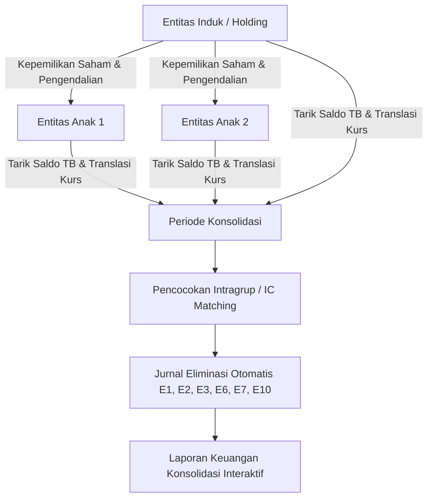
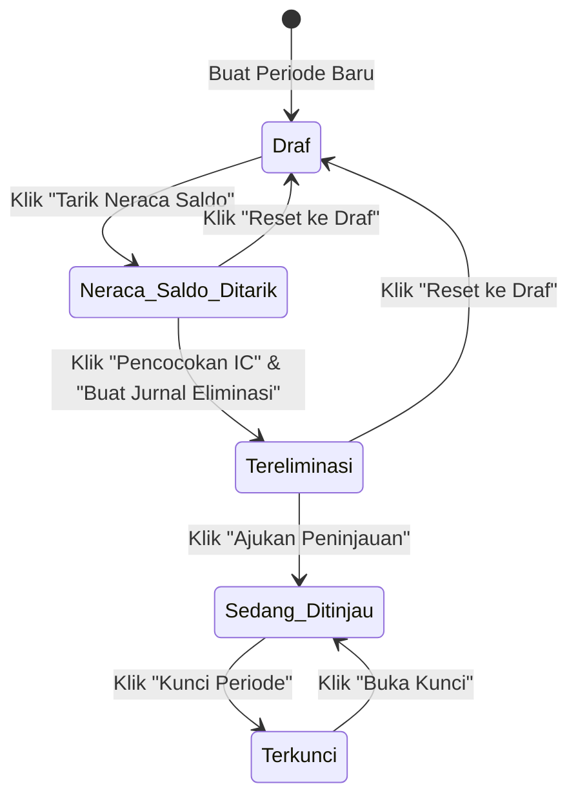

# Buku Panduan Penggunaan Modul Konsolidasi Keuangan (PSAK 65 / IFRS 10)
**Odoo 19 Enterprise / Community – Edisi Bahasa Indonesia**

---

## Daftar Isi
1. [Pendahuluan & Konsep Dasar Konsolidasi](#1-pendahuluan--konsep-dasar-konsolidasi)
2. [Hak Akses Pengguna & Struktur Menu](#2-hak-akses-pengguna--struktur-menu)
3. [Tahap 1: Pengaturan & Konfigurasi Master Data](#3-tahap-1-pengaturan--konfigurasi-master-data)
   - [3.1 Grup Konsolidasi (`consol.group`)](#31-grup-konsolidasi-consolgroup)
   - [3.2 Entitas Anggota Konsolidasi (`consol.entity`)](#32-entitas-anggota-konsolidasi-consolentity)
   - [3.3 Struktur Kepemilikan & Pengendalian (`consol.ownership`)](#33-struktur-kepemilikan--pengendalian-consolownership)
   - [3.4 Bagan Akun Konsolidasi / COA (`consol.account`)](#34-bagan-akun-konsolidasi--coa-consolaccount)
   - [3.5 Pemetaan Akun Entitas (`consol.account.mapping`)](#35-pemetaan-akun-entitas-consolaccountmapping)
   - [3.6 Kurs Valuta Asing PSAK 10 (`consol.rate`)](#36-kurs-valuta-asing-psak-10-consolrate)
   - [3.7 Aturan Eliminasi Standar PSAK 65 (`consol.elimination.rule`)](#37-aturan-eliminasi-standar-psak-65-consoleliminationrule)
4. [Tahap 2: Menjalankan Siklus Operasional Konsolidasi Periode](#4-tahap-2-menjalankan-siklus-operasional-konsolidasi-periode)
   - [4.1 Siklus Status Periode Konsolidasi (`consol.period`)](#41-siklus-status-periode-konsolidasi-consolperiod)
   - [4.2 Panduan Tombol Aksi Kerja (Step-by-Step Operasional)](#42-panduan-tombol-aksi-kerja-step-by-step-operasional)
   - [4.3 Neraca Saldo Entitas (`consol.trial.balance`)](#43-neraca-saldo-entitas-consoltrialbalance)
   - [4.4 Rekonsiliasi & Pencocokan Transaksi Antar-Perusahaan (`consol.intercompany.match`)](#44-rekonsiliasi--pencocokan-transaksi-antar-perusahaan-consolintercompanymatch)
   - [4.5 Jurnal Eliminasi Otomatis & Penyesuaian Manual (`consol.journal`)](#45-jurnal-eliminasi-otomatis--penyesuaian-manual-consoljournal)
5. [Tahap 3: Menampilkan & Menganalisis Laporan Keuangan Konsolidasi](#5-tahap-3-menampilkan--menganalisis-laporan-keuangan-konsolidasi)
   - [5.1 Membuka Menu Laporan Keuangan](#51-membuka-menu-laporan-keuangan)
   - [5.2 Menggunakan Filter Periode & Rentang Tanggal](#52-menggunakan-filter-periode--rentang-tanggal)
   - [5.3 Mode Komparasi & Pengaturan Tampilan Kolom](#53-mode-komparasi--pengaturan-tampilan-kolom)
   - [5.4 Fitur Unfold / Drill-down Rincian Akun](#54-fitur-unfold--drill-down-rincian-akun)
6. [Kamus Istilah & Singkatan (Glossary)](#6-kamus-istilah--singkatan-glossary)

---

## 1. Pendahuluan & Konsep Dasar Konsolidasi

Modul Konsolidasi Keuangan ini dirancang khusus untuk memenuhi standar akuntansi keuangan Indonesia **PSAK 65 / IFRS 10 (Laporan Keuangan Konsolidasian)**, **PSAK 10 / IAS 21 (Pengaruh Perubahan Kurs Valuta Asing)**, dan **PSAK 22 / IFRS 3 (Kombinasi Bisnis)**.



### Konsep Inti yang Diterapkan:
1. **Entitas Induk (*Parent*)**: Perusahaan pengendali tertinggi yang menyajikan laporan keuangan gabungan.
2. **Entitas Anak (*Subsidiary*)**: Perusahaan yang dikendalikan oleh entitas induk.
3. **Kepentingan Non-Pengendali (*Non-Controlling Interest / NCI*)**: Porsi ekuitas dan laba/rugi entitas anak yang tidak dimiliki oleh induk perusahaan (misal: jika induk memiliki 80%, maka NCI memiliki 20%).
4. **Mata Uang Fungsional (*Functional Currency / FC*) vs Pelaporan (*Reporting Currency / RC*)**:
   - Saldo lokal entitas anak dicatat dalam FC.
   - Sistem mentranslasikan FC ke RC (Rupiah / IDR) menggunakan kurs penutup untuk aset/liabilitas, kurs rata-rata untuk pendapatan/beban, dan kurs historis untuk ekuitas. Selisih translasi dialokasikan ke **CTA (*Cumulative Translation Adjustment*)**.
5. **Eliminasi Intragrup**:
   - Saldo investasi induk pada anak dieliminasi terhadap modal saham anak (**E1**).
   - Pengakuan bagian ekuitas pihak non-pengendali (**E2**).
   - Saldo piutang dan utang resiprokal antar-perusahaan dihapuskan (**E3**).
   - Transaksi pendapatan dan beban/HPP resiprokal dihapuskan (**E6**).
   - Pembagian laba bersih tahun berjalan kepada NCI diakui (**E7**).

---

## 2. Hak Akses Pengguna & Struktur Menu

Modul ini memiliki 3 tingkatan hak akses pada menu **Pengaturan > Pengguna & Perusahaan > Pengguna**:

| Tingkat Akses | Hak Akses (*Security Group*) | Wewenang Kerja |
| :--- | :--- | :--- |
| **Auditor / Peninjau** | `group_consolidation_auditor` | Hanya dapat melihat (*read-only*) laporan keuangan, neraca saldo, pencocokan intragrup, dan jurnal eliminasi. |
| **Pengguna Operasional** | `group_consolidation_user` | Dapat membuat periode konsolidasi, menarik saldo trial balance, menjalankan rekonsiliasi intragrup, membuat jurnal eliminasi, dan mengajukan review. |
| **Manajer Konsolidasi** | `group_consolidation_manager` | Hak penuh mengonfigurasi grup, entitas, kepemilikan saham, bagan akun konsolidasi, pemetaan akun, aturan eliminasi, mengunci (*lock*) dan membuka kunci (*unlock*) periode. |

### Struktur Navigasi Menu:
* **Konsolidasi**
  * **Operasional**:
    * *Periode Konsolidasi*: Dashboard utama alur kerja tutup buku konsolidasi.
    * *Neraca Saldo Entitas*: Kumpulan saldo akun dari seluruh anak dan induk perusahaan.
    * *Pencocokan Antar-Perusahaan*: Layar rekonsiliasi transaksi intragrup dan kontrol selisih.
    * *Jurnal Eliminasi*: Daftar seluruh entri jurnal eliminasi otomatis dan manual.
  * **Laporan Keuangan**:
    * *Laporan Posisi Keuangan (Neraca)*
    * *Laporan Laba Rugi & OCI*
    * *Laporan Arus Kas*
    * *Laporan Perubahan Ekuitas*
    * *Kertas Kerja Konsolidasi (Worksheet)*
    * *Analisis Kepemilikan & NCI*
    * *Konfigurasi Template Laporan*
  * **Pengaturan**:
    * *Grup Konsolidasi*, *Entitas Konsolidasi*, *Struktur Kepemilikan*, *Bagan Akun Konsolidasi (COA)*, *Salin Master Akun dari Perusahaan*, *Pemetaan Akun Entitas*, *Pemetaan Akun Otomatis*, *Kurs Valuta Asing (PSAK 10)*, *Aturan Eliminasi (PSAK 65)*.

---

## 3. Tahap 1: Pengaturan & Konfigurasi Master Data

Sebelum menjalankan siklus konsolidasi pertama kali, pastikan konfigurasi dasar telah dilengkapi dengan urutan berikut:

### 3.1 Grup Konsolidasi (`consol.group`)
Menu: **Pengaturan > Grup Konsolidasi**

Grup Konsolidasi adalah wadah organisasi tertinggi yang mendefinisikan batas pelaporan konsolidasi.

#### Daftar Kolom / Field:
* **Nama Grup Konsolidasi (`name`)**: Nama grup, misal `PT Indonesia Jaya Group`.
* **Perusahaan Induk Tertinggi (`parent_company_id`)**: Perusahaan Odoo yang bertindak sebagai entitas induk (*Holding*).
* **Entitas Konsolidasi Induk (`parent_entity_id`)**: Profil entitas konsolidasi yang mewakili perusahaan induk.
* **Mata Uang Pelaporan (`currency_id`)**: Mata uang penyajian akhir laporan konsolidasi (misal: `IDR`).
* **Awal Tahun Fiskal (`fiscal_year_start`)**: Bulan awal pembukuan tahunan (biasanya `Januari`).
* **Faktor Pembulatan Laporan (`rounding`)**: Pilihan nilai penyajian angka laporan (`1.0` untuk Rupiah penuh, `1.000` untuk ribuan, `1.000.000` untuk jutaan).
* **Akun Selisih Kurs Translasi / CTA (`cta_account_id`)**: Akun penampung selisih kurs translasi mata uang asing sesuai PSAK 10 (misal: `304000 - Selisih Translasi Valuta Asing (CTA)`).
* **Akun Kepentingan Non-Pengendali / Ekuitas (`nci_equity_account_id`)**: Akun NCI di neraca posisi keuangan (misal: `305000 - Kepentingan Non-Pengendali (NCI)`).
* **Akun Bagian Laba Rugi NCI (`nci_pl_account_id`)**: Akun atribusi laba bersih untuk NCI di laporan laba rugi (misal: `701000 - Bagian Laba Bersih Kepentingan Non-Pengendali`).
* **Akun Goodwill Konsolidasi (`goodwill_account_id`)**: Akun goodwill aset tidak berwujud (misal: `121000 - Goodwill Konsolidasi`).
* **Akun Saldo Laba Konsolidasi (`retained_earnings_account_id`)**: Akun saldo laba gabungan (misal: `303000 - Saldo Laba (Retained Earnings)`).
* **Batas Toleransi Selisih Intragrup (`ic_tolerance`)**: Nilai maksimal selisih transaksi intragrup yang ditoleransi sistem sebelum periode dapat dikunci (disarankan `0.00`).
* **Entitas Anggota (`entity_ids`)**: Daftar entitas anak yang tergabung ke dalam grup ini.

---

### 3.2 Entitas Anggota Konsolidasi (`consol.entity`)
Menu: **Pengaturan > Entitas Konsolidasi**

Setiap anak perusahaan atau unit usaha yang akan dikonsolidasikan wajib didaftarkan sebagai Entitas Konsolidasi.

#### Daftar Kolom / Field:
* **Nama Entitas (`name`)**: Nama lengkap perusahaan, misal `PT Anak Mandiri Sentosa`.
* **Kode Entitas (`code`)**: Kode singkatan unik (maksimal 15 karakter), misal `AMS` atau `C1`. Kode ini akan muncul sebagai judul kolom pada kertas kerja laporan.
* **Sumber Data (`source_type`)**:
  - `Database Odoo Lokal`: Jika data keuangan perusahaan berada di database Odoo yang sama (*multi-company*).
  - `Impor Eksternal (CSV/Excel)`: Jika perusahaan berada di sistem software akuntansi lain atau database terpisah.
* **Perusahaan Odoo Internal (`company_id`)**: Relasi ke `res.company` Odoo jika sumber data adalah lokal.
* **Mata Uang Fungsional (`functional_currency_id`)**: Mata uang utama operasional entitas tersebut (misal: `IDR`, `USD`, atau `SGD`).
* **Kontak/Mitra Representasi Entitas (`partner_id`)**: Data partner Odoo yang mewakili entitas ini. Field ini **sangat penting** karena sistem menggunakan kontak partner ini untuk mencocokkan transaksi piutang/utang antar-perusahaan secara otomatis.
* **Entitas Investasi (`is_investment_entity`)**: Dicentang hanya jika entitas ini berstatus perusahaan investasi murni sesuai PSAK 65 par. 31 yang dikecualikan dari konsolidasi penuh.

---

### 3.3 Struktur Kepemilikan & Pengendalian (`consol.ownership`)
Menu: **Pengaturan > Struktur Kepemilikan**

Menentukan persentase kepemilikan modal dan hak suara antara induk dan anak perusahaan.

#### Daftar Kolom / Field:
* **Entitas Induk / Pemilik (`parent_id`)**: Entitas pemegang saham (misal: `PT Indonesia HO`).
* **Entitas Anak / Investee (`child_id`)**: Entitas anak yang dimiliki sahamnya (misal: `Company 2`).
* **Kepemilikan Langsung (%) (`percentage`)**: Persentase kepemilikan saham langsung (misal: `80.00%`).
* **Hak Suara (%) (`voting_percentage`)**: Persentase hak pengendalian dalam RUPS.
* **Metode Akuntansi (`method`)**:
  - `Konsolidasi Penuh (PSAK 65 / IFRS 10)`: Untuk kepemilikan di atas 50% atau memiliki kendali mayoritas.
  - `Metode Ekuitas (PSAK 15 / IAS 28)`: Untuk entitas asosiasi (kepemilikan 20% – 50%).
  - `Nilai Wajar melalui Laba Rugi (PSAK 71)`: Untuk kepemilikan instrumen investasi minoritas (< 20%).
* **Tanggal Memperoleh Pengendalian (`date_from`)**: Tanggal efektif akuisisi pengendalian.
* **Metode Pengukuran Awal NCI (`nci_measurement`)**:
  - `Bagian Proporsional Aset Bersih Teridentifikasi`: NCI diukur proporsional dari ekuitas tercatat (umum digunakan).
  - `Nilai Wajar`: NCI diukur berdasarkan harga wajar pasar saham.
* **Kepemilikan Efektif (%) (`effective_percentage`)**: Dihitung otomatis oleh sistem dengan mengalikan jalur kepemilikan langsung maupun bertingkat.
* **Kepentingan Non-Pengendali / NCI (%) (`nci_percentage`)**: Dihitung otomatis:
  $$\text{NCI (\%)} = 100\% - \text{Kepemilikan Efektif (\%)} \quad (\text{Contoh: } 100\% - 80\% = 20\%)$$
* **Nilai Goodwill Saat Akuisisi (`goodwill_amount`)**: Nilai goodwill tercatat dari kombinasi bisnis.
* **Nilai NCI Saat Akuisisi (`nci_at_acquisition`)**: Nilai rupiah NCI pada tanggal akuisisi.

---

### 3.4 Bagan Akun Konsolidasi / COA (`consol.account`)
Menu: **Pengaturan > Bagan Akun Konsolidasi (COA)**

Bagan Akun Konsolidasi adalah bagan akun standar (*Unified Chart of Accounts*) yang menjadi target konsolidasi dari seluruh bagan akun anak perusahaan.

#### Daftar Kolom / Field:
* **Kode Akun (`code`)**: Kode akun konsolidasi, misal `111100` (Kas & Bank).
* **Nama Akun (`name`)**: Nama akun konsolidasi.
* **Tipe Akun (`account_type`)**: Klasifikasi pos akun (Kas & Bank, Piutang Usaha, Aset Tetap, Utang Usaha, Ekuitas, Pendapatan Usaha, HPP, Beban Operasional, dll).
* **Kelompok Laporan Keuangan (`statement`)**:
  - `Laporan Posisi Keuangan (Neraca)`: Aset, Liabilitas, dan Ekuitas.
  - `Laporan Laba Rugi`: Pendapatan dan Beban.
  - `Penghasilan Komprehensif Lain (OCI)`: Pos penghasilan komprehensif lainnya.
  - `Laporan Perubahan Ekuitas`: Pos mutasi modal dan dividen.
  - `Memo Arus Kas`: Untuk pemetaan arus kas tidak langsung.
* **Tipe Kurs Translasi PSAK 10 (`translation_rate`)**:
  - `Kurs Penutupan (Closing Rate)`: Untuk seluruh akun Aset dan Liabilitas.
  - `Kurs Rata-Rata (Average Rate)`: Untuk seluruh akun Laba Rugi (Pendapatan & Beban).
  - `Kurs Historis (Historical Rate)`: Untuk akun Ekuitas / Modal Saham.
* **Akun Antar-Perusahaan / Intercompany (`is_intercompany`)**: Wajib dicentang jika akun ini menampung transaksi timbal balik antar-entitas (misal Piutang Intragrup, Utang Intragrup, Penjualan Intragrup, HPP Intragrup).
* **Akun Lawan Antar-Perusahaan (`ic_counterpart_id`)**: Pasangan akun eliminasinya (misal: *Piutang Intragrup* berpasangan dengan *Utang Intragrup*).

> [!TIP]
> **Cara Cepat Membuat Bagan Akun Konsolidasi:**
> Gunakan menu **Pengaturan > Salin Master Akun dari Perusahaan** (`consol.import.company.coa.wizard`). Pilih perusahaan induk sebagai referensi, centang *"Petakan Otomatis Akun Setelah Disalin"*, lalu klik **Salin Akun & Petakan**. Seluruh akun Odoo akan diduplikasi menjadi Bagan Akun Konsolidasi dan langsung terpetakan secara instan!

---

### 3.5 Pemetaan Akun Entitas (`consol.account.mapping`)
Menu: **Pengaturan > Pemetaan Akun Entitas**

Setiap akun buku besar di entitas lokal harus dipetakan ke satu akun konsolidasi tujuan agar saldonya dapat ditarik dengan benar ke kertas kerja konsolidasi.

#### Daftar Kolom / Field:
* **Entitas Konsolidasi (`entity_id`)**: Entitas pemilik akun buku besar asal.
* **Akun Asal Odoo (`account_id`)**: Akun buku besar lokal Odoo entitas.
* **Kode / Nama Akun Eksternal (`external_code` / `external_name`)**: Jika menggunakan entitas impor dari luar Odoo.
* **Akun Konsolidasi Tujuan (`consol_account_id`)**: Akun tujuan di bagan akun konsolidasi.

> [!NOTE]
> Gunakan tombol menu **Pengaturan > Pemetaan Akun Otomatis** (`consol.auto.map.wizard`) untuk mencocokkan ratusan akun secara sekaligus berdasarkan kesamaan kode akun atau awalan kode akun.

---

### 3.6 Kurs Valuta Asing PSAK 10 (`consol.rate`)
Menu: **Pengaturan > Kurs Valuta Asing (PSAK 10)**

Jika grup memiliki anak perusahaan dengan mata uang fungsional yang berbeda (misalnya anak di Singapura memakai SGD atau anak di AS memakai USD), tentukan kurs konversinya per periode:
* **Kurs Penutupan (*Closing Rate*)**: Kurs per tanggal akhir periode pelaporan (untuk Neraca).
* **Kurs Rata-Rata (*Average Rate*)**: Kurs rata-rata selama bulan/periode pelaporan (untuk Laba Rugi).
* **Kurs Historis (*Historical Rate*)**: Kurs pada saat transaksi modal/akuisisi dilakukan (untuk Ekuitas).

*(Jika seluruh entitas menggunakan IDR, kurs default adalah $1,00$)*.

---

### 3.7 Aturan Eliminasi Standar PSAK 65 (`consol.elimination.rule`)
Menu: **Pengaturan > Aturan Eliminasi (PSAK 65)**

Modul telah dilengkapi dengan aturan eliminasi otomatis yang siap pakai sesuai standar PSAK:
1. **E1: Investasi pada Entitas Anak vs Ekuitas**: Menghilangkan akun investasi saham induk dan mengeliminasi modal saham serta saldo laba anak perusahaan.
2. **E2: Pengakuan Kepentingan Non-Pengendali (NCI)**: Mengakui persentase kepemilikan minoritas pada ekuitas bersih anak perusahaan.
3. **E3: Saldo Piutang / Utang Antar-Perusahaan**: Menghilangkan saldo akun piutang dan utang intragrup yang resiprokal.
4. **E6: Transaksi Pendapatan / Beban Antar-Perusahaan**: Mengeliminasi pendapatan penjualan dan beban pokok penjualan (HPP) intragrup agar tidak terjadi penggelembungan (*double counting*).
5. **E7: Atribusi Laba Rugi ke NCI**: Mengalokasikan porsi laba atau rugi bersih periode berjalan ke Kepentingan Non-Pengendali.
6. **E10: Selisih Translasi Valuta Asing (CTA)**: Mengalokasikan selisih penjabaran mata uang asing ke pos ekuitas CTA.

---

## 4. Tahap 2: Menjalankan Siklus Operasional Konsolidasi Periode

Setelah konfigurasi siap, seluruh aktivitas konsolidasi bulanan/tahunan dilakukan pada menu:
**Konsolidasi > Operasional > Periode Konsolidasi**



### 4.1 Siklus Status Periode Konsolidasi (`consol.period`)

Status periode mencerminkan tahapan audit trail penutupan buku:
1. **Draf (`draft`)**: Periode baru dibuat; data neraca saldo belum ditarik.
2. **Neraca Saldo Ditarik (`data_loaded`)**: Saldo seluruh entitas berhasil ditarik dari Odoo dan ditranslasikan ke mata uang pelaporan (RC).
3. **Terkonsolidasi & Tereliminasi (`eliminated`)**: Transaksi intragrup telah dicocokkan, jurnal eliminasi otomatis (E1, E2, E3, E6, E7) telah terbentuk.
4. **Sedang Ditinjau (`review`)**: Data selesai diproses dan siap ditinjau oleh pimpinan atau auditor keuangan.
5. **Terkunci (`locked`)**: Periode resmi ditutup dan dikunci. Tidak ada perubahan yang dapat dilakukan lagi untuk menjaga integritas laporan audit.

---

### 4.2 Panduan Tombol Aksi Kerja (Step-by-Step Operasional)

Buka form Periode Konsolidasi, lalu ikuti langkah tombol aksi secara berurutan:

```
[ 1. Tarik Neraca Saldo ] ──► [ 2. Pencocokan Antar-Perusahaan ] ──► [ 3. Buat Jurnal Eliminasi ] ──► [ 4. Hitung Alokasi NCI ] ──► [ 5. Ajukan Peninjauan ] ──► [ 6. Kunci Periode ]
```

#### Langkah 1: Buat Periode Baru
1. Klik tombol **Baru / Create**.
2. Isi **Nama Periode**, contoh: `2026-07`.
3. Pilih **Grup Konsolidasi**, contoh: `PT Indonesia HO Group`.
4. Tentukan **Tanggal Mulai** (`date_from`) dan **Tanggal Selesai** (`date_to`), contoh: `2026-07-01` s/d `2026-07-31`.
5. Klik **Simpan**.

#### Langkah 2: Klik Tombol `Tarik Neraca Saldo` (`action_load_trial_balances`)
* **Apa yang dilakukan fungsi ini?**
  1. Memvalidasi bahwa seluruh akun Odoo yang memiliki saldo sudah memiliki pemetaan (*account mapping*). Jika ada akun yang belum dipetakan, sistem akan menampilkan pesan peringatan lengkap dengan daftar nomor akunnya.
  2. Menarik mutasi saldo debit/kredit setiap entitas dari buku besar Odoo (`account.move.line`).
  3. Mengalikan saldo fungsional (`balance_fc`) dengan kurs translasi PSAK 10 yang berlaku untuk menghasilkan saldo mata uang pelaporan (`balance_rc`).
  4. Secara otomatis menghitung dan mencatat Jurnal **E10 (CTA)** jika terdapat anak perusahaan dengan valuta asing.
  5. Mengubah status periode menjadi **Neraca Saldo Ditarik**.

#### Langkah 3: Klik Tombol `Pencocokan Antar-Perusahaan` (`action_run_ic_matching`)
* **Apa yang dilakukan fungsi ini?**
  1. Mencari pasangan transaksi timbal-balik antar-anak dan induk perusahaan (misal Piutang HO vs Utang Company 2, atau Penjualan HO vs Pembelian Company 2).
  2. Menghitung selisih nilai (*variance*). Jika nilainya sama persis (selisih = Rp 0), status rekonsiliasi ditandai **Cocok (*Matched*)**.
  3. Mengupdate metrik **Total Selisih Antar-Perusahaan** dan **Jumlah Selisih Belum Cocok** di header periode.

#### Langkah 4: Klik Tombol `Buat Jurnal Eliminasi` (`action_generate_eliminations`)
* **Apa yang dilakukan fungsi ini?**
  1. **Jurnal E1**: Mengeliminasi saldo akun investasi saham induk terhadap saldo modal saham anak.
  2. **Jurnal E2**: Menghitung porsi Kepentingan Non-Pengendali (NCI) pada ekuitas bersih anak perusahaan.
  3. **Jurnal E3**: Mengeliminasi saldo resiprokal piutang dan utang antar-perusahaan.
  4. **Jurnal E6**: Mengeliminasi transaksi penjualan barang/jasa dan beban pokok penjualan (HPP) antar-perusahaan.
  5. Mengubah status periode menjadi **Terkonsolidasi & Tereliminasi**.

#### Langkah 5: Klik Tombol `Hitung Alokasi NCI` (`action_compute_nci`)
* **Apa yang dilakukan fungsi ini?**
  1. Menghitung laba/rugi bersih tahun berjalan dari entitas anak yang dimiliki sebagian (< 100%).
  2. Mengalikan laba bersih anak dengan persentase NCI (contoh: 20% × Laba Bersih Company 2).
  3. Secara otomatis membentuk **Jurnal E7 (Alokasi Laba Bersih ke NCI)**.

#### Langkah 6: Klik Tombol `Ajukan Peninjauan` (`action_submit_review`)
* Memindahkan status menjadi **Sedang Ditinjau** untuk proses audit dan verifikasi manajerial.

#### Langkah 7: Klik Tombol `Kunci Periode` (`action_lock`)
* **Apa yang dilakukan fungsi ini?**
  1. Memeriksa apakah masih ada selisih intragrup yang belum terselesaikan di atas batas toleransi.
  2. Mengunci data periode secara permanen, mencatat nama pengguna yang mengunci (`locked_by`) dan waktu penguncian (`locked_date`).
  3. Mengubah status menjadi **Terkunci**.

> [!NOTE]
> Jika ditemukan koreksi akuntansi setelah periode dikunci, Manajer Konsolidasi dapat mengklik tombol **Buka Kunci (`action_unlock`)**, melakukan perbaikan, lalu mengunci kembali. Tombol **Reset ke Draf (`action_reset_draft`)** akan membersihkan seluruh neraca saldo dan jurnal eliminasi untuk penarikan ulang dari awal.

---

### 4.3 Neraca Saldo Entitas (`consol.trial.balance`)
Menu: **Operasional > Neraca Saldo Entitas**

Menampilkan rincian saldo buku besar dari masing-masing anak perusahaan untuk periode yang dipilih.

#### Makna Kolom Utama:
* **Total Debit (RC)**: Penjumlahan dari seluruh akun yang bersaldo debet dalam Rupiah (Mata Uang Pelaporan).
* **Total Kredit (RC)**: Penjumlahan dari seluruh akun yang bersaldo kredit dalam Rupiah.
* **Total Saldo (RC)**: Total netto ($\text{Debit} - \text{Kredit}$). Pada pembukuan yang seimbang, nilai Total Saldo (RC) harus bernilai **Rp 0 (Nol)**.
* **Tab Rincian Baris Akun**:
  - `Akun Konsolidasi`: Akun tujuan konsolidasi.
  - `Akun Odoo Asal`: Akun buku besar lokal entitas.
  - `Saldo Mata Uang Fungsional (FC)`: Saldo asli dalam mata uang lokal.
  - `Kurs Diterapkan`: Kurs PSAK 10 yang digunakan.
  - `Saldo Mata Uang Pelaporan (RC)`: Saldo hasil konversi ke Rupiah.

---

### 4.4 Rekonsiliasi & Pencocokan Transaksi Antar-Perusahaan (`consol.intercompany.match`)
Menu: **Operasional > Pencocokan Antar-Perusahaan**

Layar ini digunakan untuk memantau apakah saldo antar-anak perusahaan sudah seimbang:

| Kolom | Keterangan |
| :--- | :--- |
| **Entitas A** | Entitas pencatat transaksi pertama (misal: PT Indonesia HO). |
| **Akun Entitas A** | Akun yang digunakan Entitas A (misal: Piutang Usaha Intragrup). |
| **Saldo Entitas A (RC)** | Jumlah saldo yang dicatat oleh Entitas A. |
| **Entitas B** | Entitas mitra pencatat transaksi lawan (misal: Company 2). |
| **Akun Entitas B** | Akun lawan yang digunakan Entitas B (misal: Utang Usaha Intragrup). |
| **Saldo Entitas B (RC)** | Jumlah saldo yang dicatat oleh Entitas B. |
| **Selisih Nilai (RC)** | Selisih absolut antara Saldo Entitas A dan Entitas B. |
| **Status Rekonsiliasi** | **Cocok (*Matched*)** jika selisih Rp 0; **Belum Cocok (*Unmatched*)** jika ada selisih. |
| **Disetujui Manual (*Overridden*)** | Jika selisih kecil disebabkan perbedaan waktu pencatatan (*timing difference*), auditor dapat mencentang persetujuan manual beserta catatannya. |

---

### 4.5 Jurnal Eliminasi Otomatis & Penyesuaian Manual (`consol.journal`)
Menu: **Operasional > Jurnal Eliminasi**

Daftar seluruh jurnal penyesuaian eliminasi konsolidasi:
* **Kode Jurnal**: `E1`, `E2`, `E3`, `E6`, `E7`, atau `E10`.
* **Tipe Asal Jurnal**: `Otomatis dari Sistem` atau `Manual oleh Pengguna`.
* **Keseimbangan Jurnal**: Memastikan total debet sama dengan total kredit.
* **Fitur Jurnal Manual**: Pengguna dapat menambahkan jurnal eliminasi khusus di luar aturan otomatis dengan mengklik tombol **Baru**, mengisi baris debet/kredit akun konsolidasi, lalu mengklik **Posting Jurnal**.

---

## 5. Tahap 3: Menampilkan & Menganalisis Laporan Keuangan Konsolidasi

Setelah periode konsolidasi selesai diproses, buka menu:
**Konsolidasi > Laporan Keuangan**

### 5.1 Membuka Menu Laporan Keuangan
Pilih jenis laporan yang ingin dianalisis:
1. **Laporan Posisi Keuangan (Neraca)**: Menampilkan posisi Aset, Liabilitas, Ekuitas Induk, dan Ekuitas Kepentingan Non-Pengendali (NCI).
2. **Laporan Laba Rugi & OCI**: Menampilkan Pendapatan, HPP, Laba Kotor, Beban Operasional, Laba Bersih Konsolidasian, serta alokasi bagian laba untuk Pemilik Entitas Induk vs NCI.
3. **Laporan Arus Kas**: Menampilkan arus kas dari aktivitas operasi, investasi, dan pendanaan secara konsolidasi.
4. **Laporan Perubahan Ekuitas**: Menampilkan mutasi modal saham, saldo laba, cadangan CTA, dan NCI.
5. **Kertas Kerja Konsolidasi (*Worksheet*)**: Menampilkan matriks perbandingan kolom dari neraca saldo masing-masing entitas, kolom eliminasi, hingga kolom saldo konsolidasi akhir.

---

### 5.2 Menggunakan Filter Periode & Rentang Tanggal

Pada bagian atas antarmuka pelaporan, terdapat panel kontrol filter yang dinamis:

```
[ Pilihan Periode: Semua Periode (2026-07 s/d 2026-09) ▼ ]  [ Dari: YYYY-MM-DD ]  [ Sampai: YYYY-MM-DD ]  [ Terapkan Filter ]
```

1. **Dropdown Periode Konsolidasi**:
   - **`Semua Periode (Awal s/d Saat Ini)`**: Menampilkan laporan akumulasi penuh dari periode paling awal (contoh: Juli 2026) sampai periode terakhir (September 2026).
   - **Periode Spesifik (misal `2026-07`, `2026-08`, atau `2026-09`)**: Menampilkan laporan konsolidasi khusus untuk bulan yang dipilih.
2. **Filter Rentang Tanggal Kustom (`Start Date` & `End Date`)**:
   - Jika Anda membutuhkan laporan dengan batas tanggal khusus, masukkan tanggal pada kotak **Dari Tanggal** dan **Sampai Tanggal**, kemudian klik tombol **Terapkan Filter**. Sistem akan otomatis mengagregasikan seluruh periode konsolidasi yang bersinggungan dengan rentang tanggal tersebut.

---

### 5.3 Mode Komparasi & Pengaturan Tampilan Kolom

1. **Filter Komparasi (*Comparison*)**:
   - `Periode Sebelumnya (MoM)`: Menambahkan kolom perbandingan dengan 1 bulan sebelumnya beserta persentase kenaikan/penurunan.
   - `Periode Sama Tahun Lalu (YoY)`: Menambahkan kolom perbandingan dengan tahun sebelumnya.
   - `Tanpa Perbandingan`: Hanya menampilkan angka periode aktif.
2. **Kotak Centang Opsi Tampilan Kolom**:
   - **Tampilkan Kolom per Entitas**: Menampilkan kolom saldo individual untuk setiap perusahaan anak dan induk (misal: Kolom `PT Indonesia HO`, Kolom `Company 1`, Kolom `Company 2`).
   - **Tampilkan Kolom Eliminasi**: Menampilkan kolom debit/kredit eliminasi intragrup PSAK 65.
   - **Kolom Total Konsolidasi**: Menampilkan angka konsolidasian bersih setelah eliminasi.

---

### 5.4 Fitur Unfold / Drill-down Rincian Akun

Laporan keuangan konsolidasi dilengkapi fitur interaktif **Unfold / Drill-down baris akun**:
* Di samping setiap baris pos laporan (misal: *Aset Lancar*, *Kas dan Setara Kas*, atau *Piutang Usaha*), terdapat ikon tanda panah ekspansi:
  - Klik **`▶`** untuk **membuka (unfold)** rincian akun-akun buku besar yang menyusun pos tersebut.
  - Klik **`▼`** untuk **menutup (fold)** kembali rincian tersebut.
* Saat baris dibuka, sistem akan menampilkan rincian angka per akun asal, lengkap dengan kontribusi saldo dari masing-masing anak perusahaan serta dampak jurnal eliminasinya secara transparan.

---

## 6. Kamus Istilah & Singkatan (Glossary)

| Singkatan / Istilah | Kepanjangan / Arti | Penjelasan Singkat |
| :--- | :--- | :--- |
| **PSAK 65 / IFRS 10** | *Pernyataan Standar Akuntansi Keuangan 65* | Standar akuntansi Indonesia untuk penyusunan Laporan Keuangan Konsolidasian. |
| **PSAK 10 / IAS 21** | *Pengaruh Perubahan Kurs Valuta Asing* | Standar translasi pembukuan mata uang asing ke mata uang pelaporan. |
| **PSAK 22 / IFRS 3** | *Kombinasi Bisnis* | Standar akuntansi pengakuan goodwill dan akuisisi entitas anak. |
| **RC** | *Reporting Currency* (Mata Uang Pelaporan) | Mata uang resmi penyajian laporan konsolidasi (misal: **IDR / Rupiah**). |
| **FC** | *Functional Currency* (Mata Uang Fungsional) | Mata uang utama lingkungan operasional entitas anak. |
| **NCI** | *Non-Controlling Interest* (Kepentingan Non-Pengendali) | Hak pemegang saham minoritas di luar kendali entitas induk atas anak perusahaan. |
| **CTA** | *Cumulative Translation Adjustment* | Akun ekuitas penampung selisih kurs akibat perbedaan kurs penjabaran (Neraca vs Laba Rugi). |
| **IC** | *Intercompany* (Antar-Perusahaan) | Transaksi atau saldo timbal balik antar-entitas dalam satu grup konsolidasi. |
| **Closing Rate** | Kurs Penutupan | Kurs spot pada akhir periode tanggal pelaporan neraca. |
| **Average Rate** | Kurs Rata-Rata | Rata-rata tertimbang kurs valuta asing selama periode laporan laba rugi. |
| **Historical Rate** | Kurs Historis | Kurs valuta asing pada saat transaksi penanaman modal saham atau akuisisi awal. |
| **TB** | *Trial Balance* (Neraca Saldo) | Daftar saldo seluruh akun buku besar sebelum dilakukan eliminasi. |
| **MoM** | *Month-over-Month* | Perbandingan performa keuangan bulan berjalan terhadap bulan sebelumnya. |
| **YoY** | *Year-over-Year* | Perbandingan performa keuangan tahun berjalan terhadap tahun sebelumnya. |
